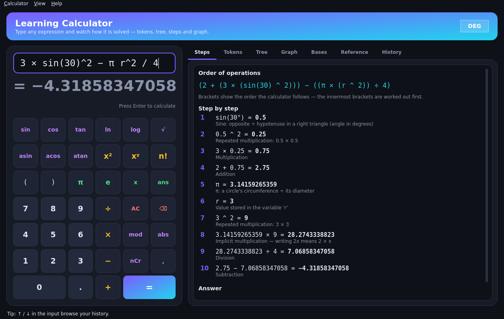
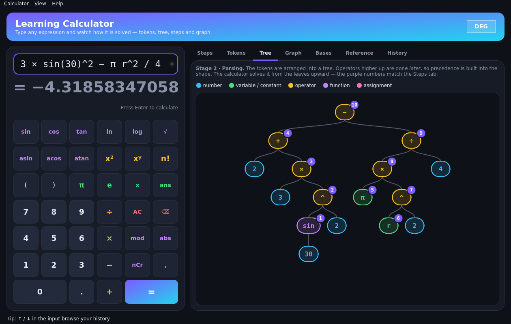
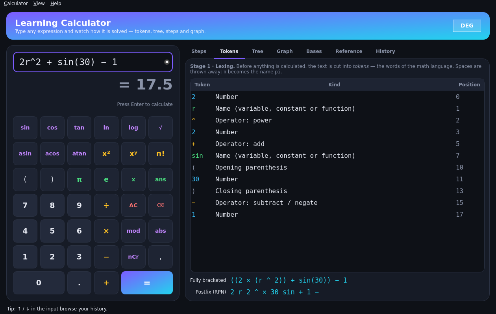
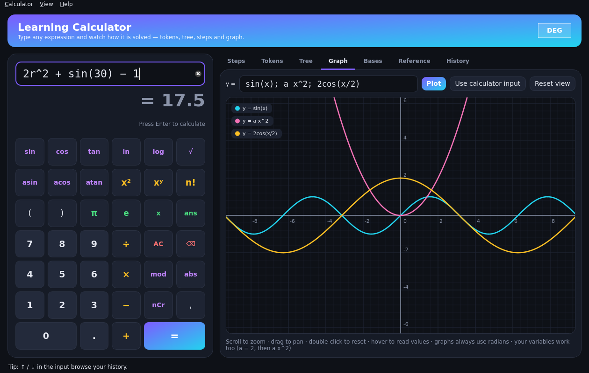
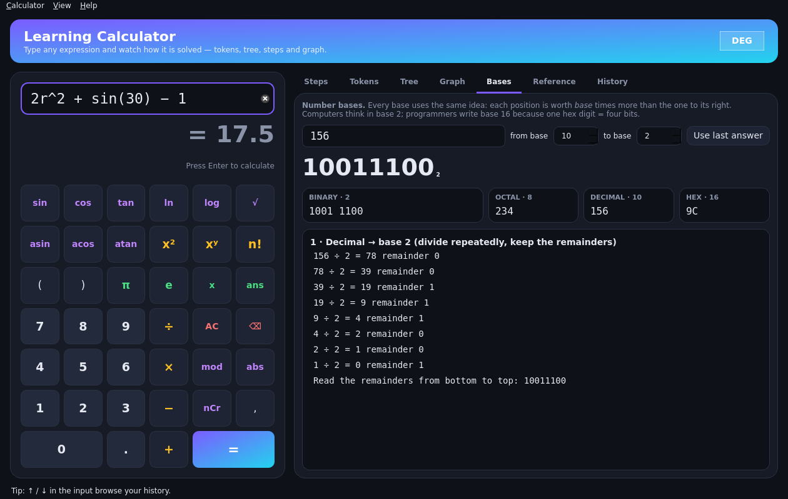
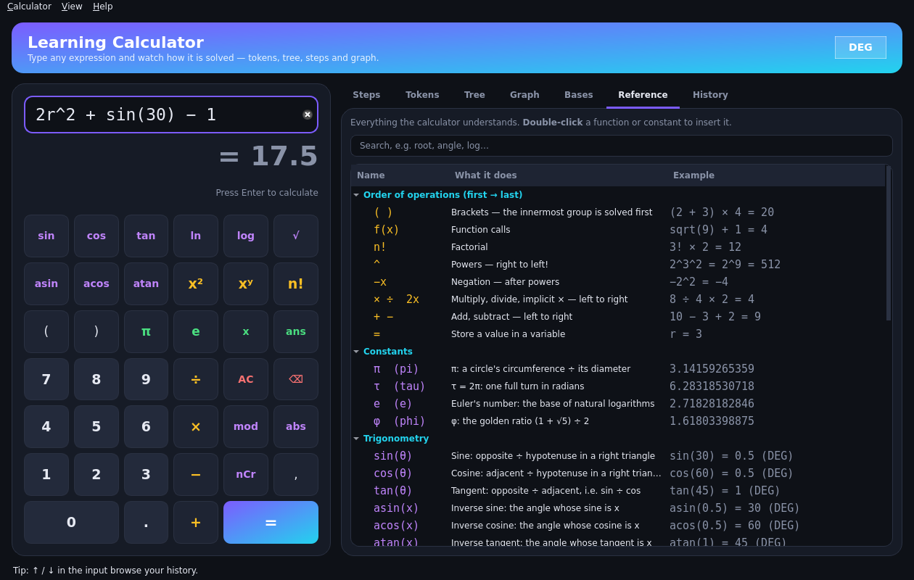
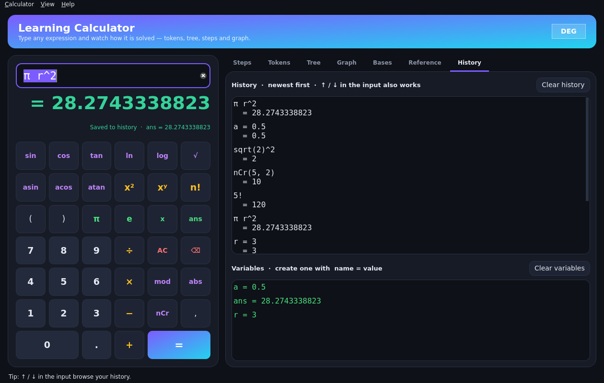
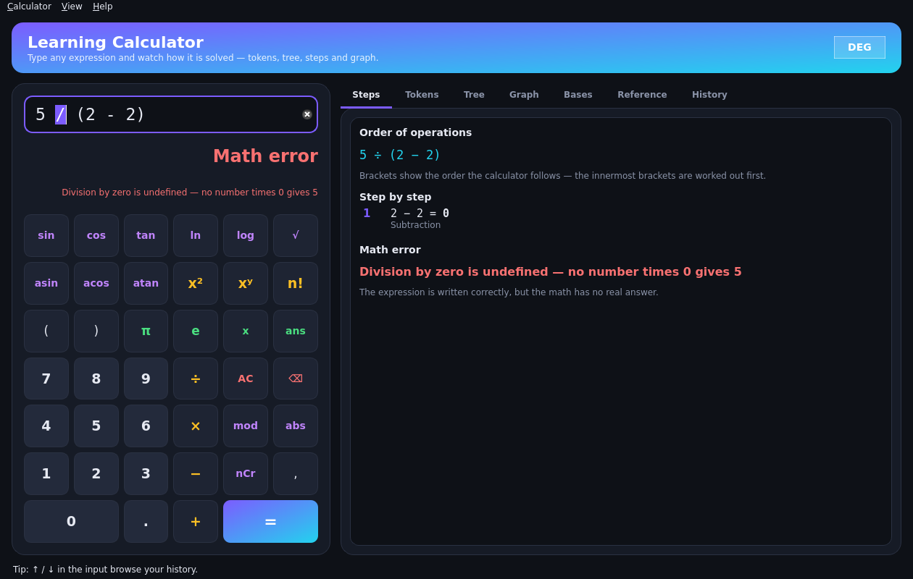
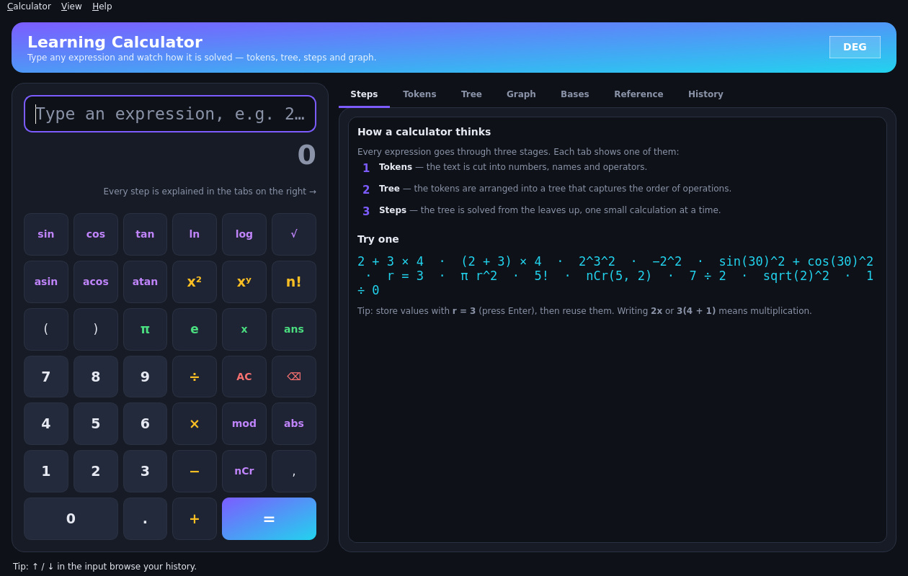

# Learning Calculator

A Qt 6 scientific calculator that **shows its work**.



## What's the "learning" part?

A normal calculator only gives you the answer. This one also shows *how* it got
there, the same way a teacher would on a whiteboard:

- **Which operation comes first:** `2 + 3 × 4` is shown as `2 + (3 × 4)`.
- **Every intermediate result**, numbered, with a one-line explanation:
  `3 × 4 = 12 — Multiplication`, `2^3 = 8 — Repeated multiplication: 2 × 2 × 2`.
- **Why something fails:** `5 / (2 − 2)` → *"Division by zero is undefined — no number
  times 0 gives 5"*, with the bad spot highlighted in the input.
- **How a computer reads math:** the text is cut into tokens, the tokens become a
  tree, and the tree is solved from the bottom up. Each stage has its own tab.

It is useful for students practising order of operations, trigonometry, logs and
number bases — and for programmers who want to see how a parser and interpreter work.

## Screenshots

### Steps — the worked solution

Order of operations, then every step with an explanation and the final answer.


### Tree — how the expression is understood

The syntax tree. Operators higher up are done later; the purple badges match the step numbers.



### Tokens — how the text is read

The expression split into tokens, plus the fully bracketed form and postfix (RPN) notation.



### Graph — plot functions of x

Several functions at once, separated by `;`. Scroll to zoom, drag to pan, hover to read values.
Your variables work too (`a = 0.5`, then `a x^2`).



### Bases — binary, octal, decimal, hex

Converts between any bases from 2 to 36, showing the repeated division (and place values) step by step.



### Reference — everything it understands

Order of operations, constants and every function, searchable. Double-click to insert.



### History & variables

Past calculations (saved between runs) and stored variables. ↑ / ↓ in the input browses history.



### Friendly errors

The error is explained, the bad character is highlighted, and the steps before the failure are kept.



### Start screen



## Features at a glance

- Live result while typing; press **Enter** or **=** to commit
- `DEG` / `RAD` toggle for trigonometry
- Variables (`r = 3`, then `π r^2`) and `ans` for the last answer
- Implicit multiplication (`2x`, `3(4 + 1)`), `**` as power, `× ÷ − π` input
- Functions: `sin cos tan asin acos atan sinh cosh tanh sqrt cbrt root exp ln log log2 logb abs round floor ceil min max mod gcd lcm fact nCr nPr`
- Constants: `π`, `τ`, `e`, `φ`
- After a result, typing an operator continues from the answer
- Keyboard: Enter, Esc (clear), ↑/↓ (history), Ctrl+1…7 (tabs)

## Quick start

```bash
make deps   # one-time: installs compiler, CMake, Ninja and Qt 6 for your OS
make run    # builds (Release) and launches the app
make test   # runs the unit tests
```

| OS | Install dependencies |
| --- | --- |
| Linux (Ubuntu 22.04+, Debian 12+, Fedora, Arch, openSUSE) | `make deps` or `scripts/install-deps-linux.sh` |
| macOS (Homebrew) | `make deps` or `scripts/install-deps-macos.sh` |
| Windows 10/11 | In PowerShell: `powershell -ExecutionPolicy Bypass -File scripts\install-deps-windows.ps1`, then use **Git Bash** for `make run` |

Run `make help` to list every target. Useful variables: `BUILD_TYPE=Debug`,
`QT_PREFIX=/path/to/Qt/6.x/gcc_64` (for a Qt from the online installer), `PREFIX=…`
for `make install`.

Without make: `cmake -S . -B build -G Ninja && cmake --build build && ./build/bin/learning-calculator`.

**Requirements:** C++17 compiler, CMake ≥ 3.16, Qt ≥ 6.2 (Core, Gui, Widgets, Test).

## Architecture

The code follows Clean Architecture: dependencies point **inwards only**, and the
mathematical core knows nothing about Qt.

```text
 ┌──────────────────────────── main (composition root) ───────────────────────────┐
 │   ┌──────────── ui (Qt Widgets) ───────────┐  ┌──── infrastructure (Qt Core) ───┐│
 │   │ MainWindow, panels, painted widgets    │  │ JsonHistoryRepository           ││
 │   └───────────────────┬────────────────────┘  └───────────────┬─────────────────┘│
 │                       ▼                                       ▼ implements port  │
 │   ┌──────────────── application (pure C++) ───────────────────────────────────┐  │
 │   │ CalculatorService · Evaluation · PlotFunction · HistoryRepository (port)  │  │
 │   └───────────────────────────────────┬───────────────────────────────────────┘  │
 │                                       ▼                                          │
 │   ┌──────────────── core (pure C++, no dependencies) ─────────────────────────┐  │
 │   │ Lexer → Parser → AST → Evaluator · AstPrinter · MathLibrary · BaseConverter│ │
 │   └───────────────────────────────────────────────────────────────────────────┘  │
 └──────────────────────────────────────────────────────────────────────────────────┘
```

```text
src/
├── core/            Domain: tokens, recursive-descent parser, AST + visitors, evaluator
├── application/     Use cases: preview / submit / plot, history port
├── infrastructure/  Adapters: JSON history file (QStandardPaths)
├── ui/              Presentation: MainWindow, widgets/ (painted), panels/ (tabs), Theme
└── main/            main.cpp — wires the concrete classes together
tests/               QtTest suites for every layer (run with `make test`)
resources/           Stylesheet (Qt resource)
scripts/             Dependency installers for Linux, macOS, Windows
docs/screenshots/    Images used in this README
```

### How an expression is evaluated

1. **Lexer** (`core/Lexer`) turns `2 + 3 × x` into tokens: `2` `+` `3` `×` `x`.
2. **Parser** (`core/Parser`) is a recursive-descent parser; each grammar rule is
   one function, from lowest precedence (`+ −`) to highest (`( )`), producing an AST.
3. **Evaluator** (`core/Evaluator`) is an AST visitor that evaluates children before
   parents — exactly the order a person follows — and records each step.

Adding a function is one line in `core/MathLibrary.cpp`; it then shows up in the
evaluator, the Reference tab and the keypad tooltips automatically.
