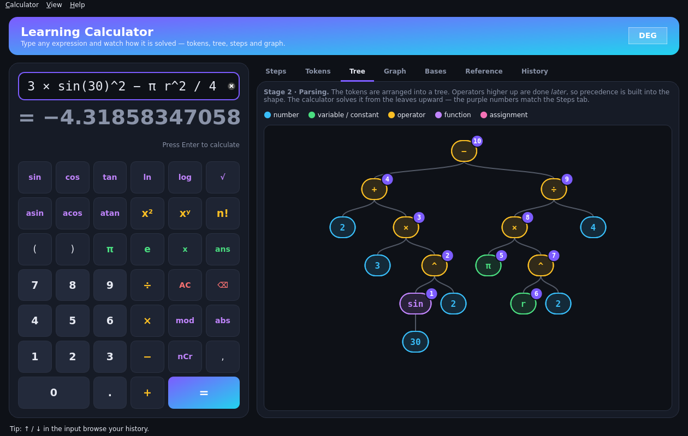

# Learning Calculator

A Qt 6 calculator that **shows its work**. Type any expression and watch how a
calculator really solves it: the text is split into tokens, the tokens become a
syntax tree, and the tree is evaluated one small step at a time — each step
explained in plain words.



## Features

| Tab | What you learn |
| --- | --- |
| **Steps** | The fully bracketed order of operations and a numbered, explained step list (`3 × 4 = 12 — Multiplication`). Errors explain *why*, e.g. *"Division by zero is undefined — no number times 0 gives 5"*. |
| **Tokens** | Stage 1 (lexing): every token with its kind and position, plus postfix / RPN notation. |
| **Tree** | Stage 2 (parsing): the syntax tree, coloured by node kind; badges match the step numbers. |
| **Graph** | Plot several functions at once (`sin(x); x^2/4`). Pan, zoom, hover to read values. |
| **Bases** | Binary / octal / decimal / hex with repeated-division and place-value steps. |
| **Reference** | Order of operations, constants and every function, searchable; double-click to insert. |
| **History** | Past calculations and stored variables (history is saved between runs). |

Also: live preview while typing, `DEG`/`RAD` toggle, variables (`r = 3`, then `π r^2`),
`ans`, implicit multiplication (`2x`, `3(4 + 1)`), `**` as power, `×  ÷  −  π` input,
↑/↓ history, and the error position highlighted in the input.

## Quick start

```bash
make deps   # one-time: installs compiler, CMake, Ninja and Qt 6 for your OS
make run    # builds (Release) and launches the app
make test   # runs the unit tests
```

| OS | Install dependencies |
| --- | --- |
| Linux (Ubuntu 22.04+, Debian 12+, Fedora, Arch, openSUSE) | `make deps` or `scripts/install-deps-linux.sh` |
| macOS (Homebrew) | `make deps` or `scripts/install-deps-macos.sh` |
| Windows 10/11 | In PowerShell: `powershell -ExecutionPolicy Bypass -File scripts\install-deps-windows.ps1`, then use **Git Bash** for `make run` |

Run `make help` to list every target. Useful variables: `BUILD_TYPE=Debug`,
`QT_PREFIX=/path/to/Qt/6.x/gcc_64` (for a Qt from the online installer), `PREFIX=…`
for `make install`.

Without make: `cmake -S . -B build -G Ninja && cmake --build build && ./build/bin/learning-calculator`.

**Requirements:** C++17 compiler, CMake ≥ 3.16, Qt ≥ 6.2 (Core, Gui, Widgets, Test).

## Architecture

The code follows Clean Architecture: dependencies point **inwards only**, and the
mathematical core knows nothing about Qt.

```
 ┌──────────────────────────── main (composition root) ───────────────────────────┐
 │   ┌──────────── ui (Qt Widgets) ───────────┐  ┌──── infrastructure (Qt Core) ───┐│
 │   │ MainWindow, panels, painted widgets    │  │ JsonHistoryRepository           ││
 │   └───────────────────┬────────────────────┘  └───────────────┬─────────────────┘│
 │                       ▼                                       ▼ implements port  │
 │   ┌──────────────── application (pure C++) ───────────────────────────────────┐  │
 │   │ CalculatorService · Evaluation · PlotFunction · HistoryRepository (port)  │  │
 │   └───────────────────────────────────┬───────────────────────────────────────┘  │
 │                                       ▼                                          │
 │   ┌──────────────── core (pure C++, no dependencies) ─────────────────────────┐  │
 │   │ Lexer → Parser → AST → Evaluator · AstPrinter · MathLibrary · BaseConverter│ │
 │   └───────────────────────────────────────────────────────────────────────────┘  │
 └──────────────────────────────────────────────────────────────────────────────────┘
```

```
src/
├── core/            Domain: tokens, recursive-descent parser, AST + visitors, evaluator
├── application/     Use cases: preview / submit / plot, history port
├── infrastructure/  Adapters: JSON history file (QStandardPaths)
├── ui/              Presentation: MainWindow, widgets/ (painted), panels/ (tabs), Theme
└── main/            main.cpp — wires the concrete classes together
tests/               QtTest suites for every layer (run with `make test`)
resources/           Stylesheet (Qt resource)
scripts/             Dependency installers for Linux, macOS, Windows
```

### How an expression is evaluated

1. **Lexer** (`core/Lexer`) turns `2 + 3 × x` into tokens: `2` `+` `3` `×` `x`.
2. **Parser** (`core/Parser`) is a recursive-descent parser; each grammar rule is
   one function, from lowest precedence (`+ −`) to highest (`( )`), producing an AST.
3. **Evaluator** (`core/Evaluator`) is an AST visitor that evaluates children before
   parents — exactly the order a person follows — and records each step.

Adding a function is one line in `core/MathLibrary.cpp`; it then shows up in the
evaluator, the Reference tab and the keypad tooltips automatically.
